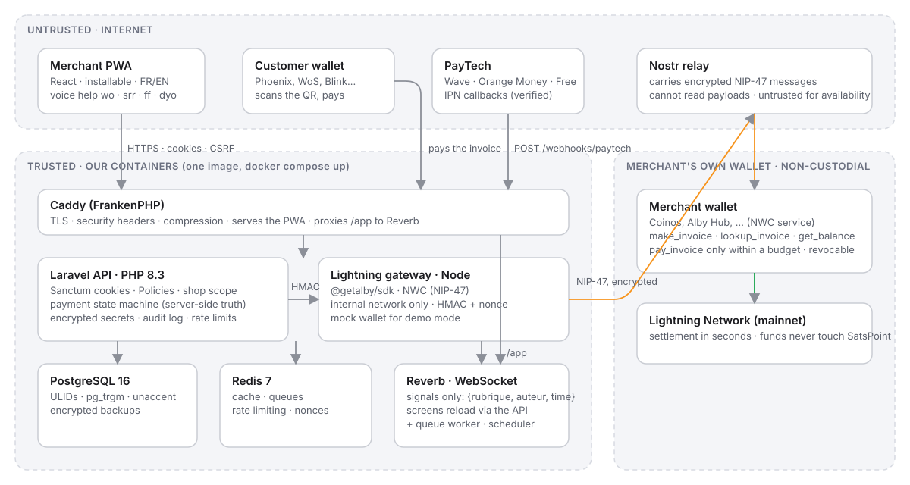

<p align="center">
  
</p>

<h1 align="center">SatsPoint</h1>

<p align="center">
  <strong>A low-bandwidth Lightning point-of-sale for African merchants.</strong><br/>
  Price in FCFA · get paid in sats in seconds · fall back to mobile money · voice guidance in Wolof, Serer, Pulaar and Jola · non-custodial by design.
</p>

<p align="center">
  <a href="#-try-it-in-two-minutes">Try it</a> ·
  <a href="#-demo">Demo</a> ·
  <a href="#-architecture">Architecture</a> ·
  <a href="#-deploy-free-render--neon">Deploy</a> ·
  <a href="#-security">Security</a> ·
  <a href="docs/CAHIER_DES_CHARGES.md">Specification (FR)</a> ·
  <a href="docs/THREAT_MODEL.md">Threat model</a>
</p>

> Built for the **Dakar Bitcoin Hack by BTrust** (October 26 – November 20, 2026). 🚧 Work in progress until the deadline — this README is updated as features land.

---

## The problem

In Dakar, a shop owner can receive money from almost anyone — except from the customer who holds Bitcoin. Merchants think in **FCFA**, live on **mobile money** (Wave, Orange Money, Free Money), and many **do not read**. Existing Bitcoin tools assume a laptop, a stable connection, English jargon and prices in dollars. The one question a merchant asks a payment tool is: **"Did I get paid — yes or no — right now?"**

**Primary user:** Awa, who sells fabric at the HLM market in Dakar. Mid-range Android phone, speaks Wolof, reads little, uses Wave every day.

### Her day, before and after

| Moment | Today | With SatsPoint |
|---|---|---|
| A customer wants to pay in bitcoin | Sale refused, or an address copied by hand with no idea how many sats to ask | Type the FCFA amount → QR → paid in seconds |
| Knowing she got paid | Wait, check the phone, trust the customer's screenshot | Green screen + sound + spoken confirmation, decided by the server |
| Customer has no bitcoin | Switch to another app | "Mobile money" tab on the same screen |
| She doesn't read | Depends on a relative | Speaker icon on every button, in her language |
| The owner is away | Calls the cashier, counts at night | Sales appear live on the owner's phone |
| End of day | Adds up by hand | Daily total, sats vs. mobile money split, export |

## ✨ What it does

- **Lightning checkout in FCFA** — live BTC/XOF rate (median of three sources, frozen per invoice, rounded up in the merchant's favour), QR invoice, countdown, one-tap renewal.
- **Instant, trustworthy confirmation** — the wallet notifies the gateway, the API re-verifies the invoice, and the merchant's screen turns green in real time. The client never decides "paid".
- **Voice guidance** in **Wolof, Serer, Pulaar, Jola** (+ French): a speaker icon on every button and on the language selector itself; audio recorded by the platform admin in a built-in studio and published to every device.
- **Mobile money fallback** through PayTech (Wave, Orange Money, Free Money) with verified IPN callbacks.
- **Merchant wallet** (required by the hackathon): balance, receive, send (owner only, with confirmation and budget), history — via **Nostr Wallet Connect**, so funds stay in the merchant's own wallet.
- **Team roles** (owner, manager, cashier), live dashboard, sales history, shareable receipts, French/English UI, light/dark themes, installable PWA.

## 🚀 Try it in two minutes

Requirements: Docker Desktop (or Docker Engine + Compose v2).

```bash
git clone https://github.com/makaGit10/SatsPoint.git
cd SatsPoint
docker compose up
```

Then open **http://localhost:8120**.

Without any configuration the stack starts in **demo mode** (a banner says so): the Lightning wallet and mobile money are **simulated** so you can run the whole flow without owning sats. Demo accounts are printed in the `api` container logs at first start (`docker compose logs api | grep -i demo`).

**Happy path (2 minutes):** pick a language (tap a speaker to hear it) → log in as the demo owner → **Caisse** → type `1500` → **Encaisser** → a QR appears → press **"Simuler le paiement"** (demo mode) → the screen turns green and says *Paiement reçu* → open **Tableau de bord** on a second browser: the sale appeared without a refresh.

**Real Lightning:** copy `.env.example` to `.env`, set `DEMO_NWC_URI` to a Nostr Wallet Connect string from your wallet (Coinos, Alby Hub, …) and restart. Invoices are then created on your real wallet (mainnet). Set `PAYTECH_API_KEY/SECRET` to enable mobile money.

## 🎬 Demo

- **Live:** `[URL — added at deployment]`
- **Video (3 min):** `[YouTube — added at submission]`
- Screenshots: `[added when the UI lands]`

## 🏗 Architecture

<p align="center"></p>

<details><summary>Text version</summary>

```
                      Internet (HTTPS only)
                               │
                        ┌──────▼──────┐
                        │    Caddy    │  TLS, headers, compression, static PWA
                        └──┬───────┬──┘
              /api /r /webhooks    │ /app (WebSocket)
                  ┌────────▼───┐ ┌──▼─────────┐
   PWA React ◄───►│ API Laravel│ │  Reverb    │◄── real-time signals (no data inside)
   (browser)      │ (PHP 8.3)  │ │ (WebSocket)│
                  └─┬──┬───┬───┘ └────────────┘
                    │  │   │ internal network, HMAC-signed requests
        ┌───────────┘  │   └──────────────┐
  ┌─────▼─────┐  ┌─────▼────┐   ┌─────────▼──────────┐        ┌───────────────┐
  │PostgreSQL │  │  Redis   │   │ Lightning gateway   │◄─────►│ Nostr relay   │◄──► Merchant's
  │           │  │cache,jobs│   │ (Node, @getalby/sdk)│  NWC  │ (NIP-47)      │     wallet
  └───────────┘  └──────────┘   └────────────────────┘        └───────────────┘
        ▲
        │ queue worker (ffmpeg audio, imports, exports) · scheduler (rates, expiries)
                                         PayTech ──IPN──► /webhooks/paytech/{shop}
```

</details>

| Layer | Choice |
|---|---|
| API | Laravel 12, Sanctum (SPA cookies), Policies, Form Requests, API Resources |
| Real-time | Laravel Reverb + Echo; signals carry `{rubrique, auteur, horodatage}` only, screens reload through the API |
| Database | PostgreSQL 16 (`pg_trgm`, `unaccent`), Redis 7 |
| Lightning | Dedicated Node gateway speaking NWC (NIP-47) via `@getalby/sdk`; HMAC-authenticated; in-memory mock wallet for demo mode |
| Front | React 19, TypeScript, Vite, Tailwind, Radix UI, TanStack Query, i18next, PWA (Workbox) |
| Infra | Docker Compose, FrankenPHP (Caddy + PHP) single image, GitHub Actions CI |

Repository layout: `api/` (Laravel) · `web/` (PWA) · `lightning-gateway/` (Node) · `infra/` (Docker, Caddy, Render) · `tests/e2e/` (Playwright) · `docs/` (specification, directives, threat model, gateway contract) · `tools/video/` (voice-over).

## 🔐 Security

Full write-up: [docs/THREAT_MODEL.md](docs/THREAT_MODEL.md).

- **Non-custodial.** No keys, no seeds, no funds. The NWC connection is encrypted at rest (AES-256-GCM, key separate from `APP_KEY`), never sent to the browser, revocable in one click; merchants are guided to set minimal permissions and a spending budget on the wallet side.
- **Payment truth is server-side.** A sale becomes "paid" only after the API re-verifies the invoice with the wallet (or validates a PayTech IPN: signature, amount, reference, idempotency).
- **Least privilege.** Cashiers cannot see balances or send; managers cannot touch wallet or PayTech settings; the platform admin cannot see merchants' money at all.
- **Authorisation everywhere.** Opaque ULIDs, Laravel Policies on every route, a global shop scope, and an automated test that sweeps every route with a foreign-shop user.
- **Hardening.** Strict input validation, rate limits, HttpOnly/SameSite cookies + CSRF, CSP and security headers, HMAC + nonce between API and gateway, no PII in logs, `composer audit`/`npm audit` in CI.

## 📏 Metrics we track

Platform console (admin): weekly active merchants · payments per merchant per week · median delay from settlement to green screen · share of sales in sats vs. mobile money · voice coverage per language. Performance budgets: initial JS ≤ 170 KB gzipped, LCP ≤ 2.5 s on "Slow 4G", settlement → green screen ≤ 2 s. Measured values: `[filled before submission]`.

## ⚠️ Constraints and known limits

- PayTech runs in **test mode** until the merchant account is activated by PayTech (real Lightning payments are live on mainnet).
- Free-tier hosting may sleep after inactivity; an uptime ping keeps the demo awake during judging.
- Voice audio must be recorded by a human per language; the MVP ships the essential checkout keys first.
- Single relay per wallet connection; multi-relay is planned.

## 🗺 Next iteration

1. **Off-ramp**: convert sats to FCFA on demand through a local exchange partner.
2. **Spoken amounts** and full voice-driven operation.
3. **Offline mode** with USSD/SMS confirmations.
4. **E-commerce plugin** reusing the same checkout.
5. **Pilot** with 10 merchants in one Dakar neighbourhood, weekly numbers published.

## 🌍 Deploy (free: Render + Neon)

One URL, one Docker image, one free Render web service. The **`all`** target of [`infra/api.Dockerfile`](infra/api.Dockerfile) runs, under supervisord and as a non-root user: Caddy + PHP (compiled PWA + Laravel API, listening on `$PORT`), Reverb (`127.0.0.1:8080`, exposed through Caddy on `/app`), the queue worker, the scheduler and the Lightning gateway (`127.0.0.1:3011`). Front, API, session cookies and WebSocket share **the same origin** — no Netlify, no CORS. PostgreSQL lives on **Neon**; there is no Redis (cache, rate limits, HMAC nonces, queues and sessions use the database).

1. **Accounts** (free, no credit card): sign up to **[Neon](https://neon.com)** and **[Render](https://render.com)** with *Continue with GitHub*; give Render access to this repository.
2. **Neon**: *New project* `satspoint`, region **AWS Europe Central 1 (Frankfurt)**; set the compute size to **0.25 CU** (min = max). *Connect* → turn **connection pooling off** (direct connection) → copy `postgresql://…neon.tech/neondb?sslmode=require`.
3. **Render**: *New* → **Blueprint** → this repository → blueprint file **`infra/render.yaml`**. Render builds the last Dockerfile stage, which is `all`.
4. Fill in the variables Render asks for:

   | Variable | Value |
   |---|---|
   | `DATABASE_URL` | the Neon connection string |
   | `SUPERADMIN_EMAIL`, `SUPERADMIN_PASSWORD` | platform owner account (password ≥ 12 chars) |
   | `DEMO_PASSWORD` | password of `demo@satspoint.local` / `caissier@satspoint.local` (≥ 12 chars, **required**) |
   | `DEMO_NWC_URI` | Coinos Nostr Wallet Connect string of the demo shop (receive-only, with a budget). Empty = simulated wallet: then also set `ALLOW_MOCK_WALLET=true` |
   | `PAYTECH_API_KEY`, `PAYTECH_API_SECRET` | PayTech test keys (empty = simulated mobile money) |

   `APP_KEY`, `DATA_ENCRYPTION_KEY`, `GATEWAY_HMAC_SECRET` and `REVERB_APP_SECRET` are generated by Render. **Never regenerate `DATA_ENCRYPTION_KEY`** (encrypted NWC/PayTech/2FA secrets would become unreadable). Public URLs (`APP_URL`, `FRONTEND_URL`, `SANCTUM_STATEFUL_DOMAINS`, `REVERB_PUBLIC_HOST`, PayTech IPN base) are derived from Render's `RENDER_EXTERNAL_URL`; set them only for a custom domain.
5. *Apply* (first build ≈ 10 min). Check `https://<service>.onrender.com/sante` (`base`, `reverb`, `passerelle` = `true`), then log in as the super-admin, **enable 2FA** (required for the platform console) and run the 1 500 FCFA demo checkout.
6. **Keep it awake**: Render free services sleep after 15 min without traffic. On **[cron-job.org](https://cron-job.org)** create a job `GET https://<service>.onrender.com/up` **every 10 minutes**. Neon's free plan has 100 CU-hours/month (≈ 16 days always-on at 0.25 CU), so enable the ping for the judging period only.

Known free-tier limits: no persistent disk (voice recordings uploaded in the studio are lost on redeploy/wake-up — re-upload them, or add a disk/object storage later), 0.1 CPU (cold start ≈ 1 min), 512 MB RAM. Full procedure (FR): [CAHIER_DES_CHARGES § 16.2](docs/CAHIER_DES_CHARGES.md#162-mise-en-ligne-gratuite--render--neon-choix-retenu).

Local check of the production image: `docker build -f infra/api.Dockerfile --target all -t satspoint/all .` then run it with `PORT`, `DATABASE_URL`, `APP_ENV=production` (see `infra/render.yaml` for the full list).

## 🧪 Development

```bash
cp .env.example .env          # then uncomment COMPOSE_FILE for the dev overlay (mounted code)
docker compose up -d          # api :8120 · reverb :8125 · postgres :5440
cd web && npm install && npm run dev   # PWA on :5190 with proxy to the API
docker compose exec api php artisan test
cd lightning-gateway && npm test
```

See [docs/DIRECTIVES.md](docs/DIRECTIVES.md) for the engineering rules (security, real-time, testing, design) and [docs/CONTRAT_PASSERELLE.md](docs/CONTRAT_PASSERELLE.md) for the API ↔ gateway contract.

## License

[MIT](LICENSE) — built in the open for the Bitcoin FOSS ecosystem.
